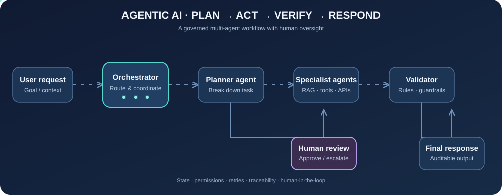

# Hi, I'm Vamshikiran Jayarapu 👋

### Senior AI / ML Engineer | Generative AI | RAG | Agentic AI

I build data- and AI-driven solutions, with a focus on applying machine learning and modern generative AI patterns to practical enterprise problems.

  

  <b>PLAN</b> &nbsp;→&nbsp; <b>ORCHESTRATE</b> &nbsp;→&nbsp; <b>ACT</b> &nbsp;→&nbsp; <b>VERIFY</b> &nbsp;→&nbsp; <b>HUMAN APPROVAL</b>

- **Experience:** 14+ years across IT, data science, and AI/ML
- **Core focus:** Generative AI, Retrieval-Augmented Generation (RAG), NLP, machine learning, and AI-enabled workflow automation
- **Engineering:** Python, SQL, REST APIs, FastAPI, cloud-based application integration
- **Cloud & data:** Google Cloud (Cloud Run, Pub/Sub, Cloud SQL), Azure, PostgreSQL
- **Domains:** Life sciences / healthcare, retail, telecom, oil & gas, and digital marketing

I value solutions that are grounded in reliable data, measurable through evaluation, and designed with validation, guardrails, observability, and human review where needed.

## Agentic AI Architecture

An agentic system is more than a chatbot: it coordinates specialized capabilities to complete a goal, while controlling tool access and validating outputs.

- **Orchestrator:** routes tasks, manages state, and coordinates agents
- **Planner:** decomposes a goal into executable steps
- **Specialist agents:** retrieve knowledge, call approved tools/APIs, and perform focused tasks
- **Validator:** checks schemas, business rules, grounding, and policy constraints
- **Human-in-the-loop:** reviews exceptions and high-impact decisions
- **Observability:** traces decisions, tool calls, retries, and outcomes

## Areas of Focus

- **RAG systems:** document ingestion, parsing, chunking, embeddings, vector retrieval, hybrid search, reranking, and retrieval evaluation
- **LLM applications:** prompt design, structured outputs, grounding, and response validation
- **AI agents:** agent workflows, orchestration patterns, tool integration, and human-in-the-loop controls
- **Applied ML & data science:** predictive modelling, NLP, analytics, and feature engineering
- **Cloud integration:** API-driven services, asynchronous messaging, and data persistence

## Selected Repositories

A few repositories that reflect my learning and hands-on exploration:

| Topic | Repository |
|---|---|
| Retrieval-Augmented Generation | [Retrieval-Augmented-Generation](https://github.com/JVK1987/Retrieval-Augmented-Generation) |
| RAG patterns and techniques | [RAG_Techniques](https://github.com/JVK1987/RAG_Techniques) |
| Generative AI agents | [GenAI_Agents](https://github.com/JVK1987/GenAI_Agents) |
| Agentic AI learning roadmap | [Roadmap-To-Learn-Agentic-AI](https://github.com/JVK1987/Roadmap-To-Learn-Agentic-AI) |
| LLM engineering resources | [llm-engineer-toolkit](https://github.com/JVK1987/llm-engineer-toolkit) |
| MLOps learning | [mlops-zoomcamp](https://github.com/JVK1987/mlops-zoomcamp) |

## Technology Stack

**Languages:** Python, SQL, R

**AI / ML:** Machine Learning, NLP, Generative AI, LLMs, RAG, embeddings, vector search, prompt engineering

**Frameworks & APIs:** FastAPI, REST APIs

**Cloud & Data:** Google Cloud Platform, Microsoft Azure, PostgreSQL, Pub/Sub, Cloud Run, Cloud SQL

## What I'm Exploring

- Improving RAG quality through hybrid retrieval, reranking, and systematic evaluation
- Building reliable agentic workflows with validation, permissions, and human oversight
- Strengthening production engineering practices for AI services, including deployment, monitoring, and operational reliability

---

*This profile highlights my professional focus and selected hands-on learning repositories. Repository contents indicate the implementation and maturity of each individual project.*
